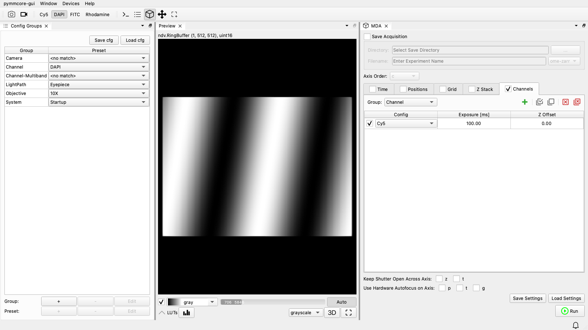

# pymmcore-gui

**pymmcore-gui** is a desktop application for controlling microscopes with the
Micro-Manager core, written in Python.  It's built from the other packages on this
site (plus [ndv](https://github.com/pyapp-kit/ndv) for viewing images), and the goal
is to provide a pure-Python replacement for Micro-Manager's Java GUI (MMStudio).

!!! info "Name pending"

    *pymmcore-gui* is a working title.  The application is usable today, but
    expect rough edges and frequent changes.

{ loading=lazy }

## Who it's for

pymmcore-gui is for people who want to *use* a microscope from a Python application
the way they'd use MMStudio: load a configuration, look at the live image, set up a
multi-dimensional acquisition and run it, without writing code.  It's also a place to
start if you're a developer who'd rather add a few panels to an existing application
than build a GUI from scratch with [pymmcore-widgets](../pymmcore-widgets/index.md).
You can [add your own widgets](usage.md#adding-your-own-widget), and
[script the running GUI](usage.md#the-console) from its built-in console.

!!! question "pymmcore-gui or napari-micromanager?"

    [napari-micromanager](../napari-micromanager/index.md) came first.  It's a
    [napari](https://napari.org) plugin built from the same widgets, in which images
    become napari layers.  It's still maintained, but new development is going into
    pymmcore-gui, which uses ndv instead of napari (for performance, and to keep the
    dependencies down).  If your analysis already lives in napari,
    napari-micromanager may suit you better; otherwise, start with pymmcore-gui.

## What's inside

| Component | Role in the GUI |
| --- | --- |
| [pymmcore-plus](../pymmcore-plus/index.md) | Device control and the acquisition engine ([`CMMCorePlus`][pymmcore_plus.CMMCorePlus], [`MDAEngine`][pymmcore_plus.mda.MDAEngine]). |
| [useq-schema](../useq-schema/index.md) | Describes the experiments you run: time-lapses, z-stacks, channels, well plates, grids, ... |
| [pymmcore-widgets](../pymmcore-widgets/widgets/index.md) | The panels: camera and stage control, property browser, acquisition setup, ... |
| [ndv](https://github.com/pyapp-kit/ndv) | Fast, lightweight n-dimensional viewer for live and acquired images. |

## Features

- Device control and configuration (including the Hardware Configuration Wizard)
- Multi-dimensional acquisitions: time, z, channels, positions, grids, well plates
- Real-time image preview and acquisition visualization (2D and 3D)
- Customizable, dockable layouts
- An integrated IPython console with access to the running core
- Double-clickable application bundles for Windows and macOS

## Next steps

To try it out, [install pymmcore-gui](install.md) (as a Python package or a bundled
app), then see [Using pymmcore-gui](usage.md) for launching it, its command-line
options, and scripting it from Python.  The [API reference](api/pymmcore_gui/index.md)
documents the parts you can build on.
